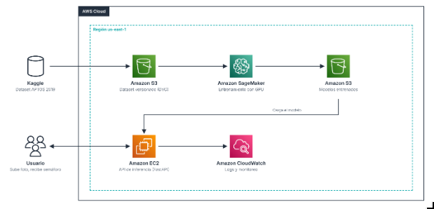

# Detección temprana de Retinopatía Diabética para evitar ceguera

Proyecto de la materia *Integración de Servicios de Aprendizaje Automático* (ITESO).
Equipo: Kevin Ayala y Eduardo Navarro.

## 1. Problema

La retinopatía diabética es una complicación de la diabetes que daña los vasos sanguíneos de la
retina. Es la principal causa de ceguera prevenible en adultos en edad productiva, y como al
principio no da síntomas, muchos pacientes llegan con el especialista cuando el daño ya está avanzado.

En México el problema es grande. El porcentaje de adultos con diagnóstico de diabetes pasó de 9.2%
en 2012 a 10.3% en 2018, y en estudios mexicanos entre el 38.9% y el 60.1% de las personas con
diabetes tiene algún grado de retinopatía. Además, hay pocos especialistas: unos 42.5
oftalmólogos por millón de habitantes, frente a más de 100 en países como España o Argentina. Eso
hace que la detección temprana muchas veces no llegue a tiempo.

### ¿Por qué ML?

El diagnóstico se hace revisando fotos del fondo de ojo, y hacerlo a mano no escala cuando hay
millones de pacientes y pocos oftalmólogos. Un modelo de clasificación de imágenes puede analizar
cada foto en segundos y estimar el nivel de severidad, para priorizar a quién referir primero.
No reemplaza al médico: funciona como un filtro de tamizaje.

Este enfoque ya se está probando en Jalisco, donde el Tec de Monterrey desarrolla un sistema de IA
que detecta la retinopatía sin un oftalmólogo presente. Nosotros tomamos esa idea como caso de
estudio para construir el ciclo completo: entrenar, desplegar y monitorear el modelo en la nube.

## 2. Dataset

[APTOS 2019 Blindness Detection | Kaggle](https://www.kaggle.com/competitions/aptos2019-blindness-detection)

Usamos el dataset APTOS 2019 Blindness Detection de Kaggle, creado por el Aravind Eye Hospital de
India con fotos de retina tomadas en zonas rurales.

Tiene 3,662 imágenes etiquetadas por médicos en 5 niveles:

| Clase | Nivel | Imágenes |
|---|---|---|
| 0 | Sin retinopatía | 1,805 |
| 1 | Leve | 370 |
| 2 | Moderada | 999 |
| 3 | Severa | 193 |
| 4 | Proliferativa | 295 |

Las dividiremos en entrenamiento, validación y prueba.

El dataset está desbalanceado, porque casi la mitad son ojos sanos, y las fotos vienen de distintas
cámaras y calidades. Por eso habrá que preprocesarlas y usar métricas más allá de accuracy.

## 3. Servicios de AWS

- **Amazon S3:** almacenamiento central del proyecto. Guarda el dataset original (imágenes y
  etiquetas), los modelos entrenados y el registro de cada predicción que hace la API.
- **Amazon SageMaker AI:** lo usamos para entrenar los modelos. Lanzamos trabajos de entrenamiento
  en instancias con GPU que leen las imágenes desde S3 y, al terminar, guardan el modelo entrenado
  de vuelta en S3. La instancia se apaga sola al finalizar, así que solo se paga el tiempo de
  entrenamiento.
- **Amazon EC2:** es el servidor donde corre nuestra API con FastAPI. Descarga el modelo desde S3,
  recibe una foto de fondo de ojo y regresa el nivel de severidad estimado (0 a 4) con su
  probabilidad.
- **Amazon CloudWatch:** recibe los logs y métricas del entrenamiento en SageMaker y monitorea la
  API: número de predicciones, tiempo de respuesta, errores y distribución de predicciones por clase.

## 4. Arquitectura



1. El dataset de Kaggle se sube a **Amazon S3**, versionado con DVC.
2. **SageMaker AI** lee las imágenes de S3, entrena el modelo con GPU y guarda el modelo entrenado en S3.
3. **EC2** carga el modelo desde S3 y expone la API de inferencia con FastAPI.
4. El usuario sube una foto de fondo de ojo y recibe un resultado tipo **semáforo** según la severidad.
5. **CloudWatch** registra los logs y monitorea la API.

Más detalle en [docs/arquitectura.md](docs/arquitectura.md).

## 5. Estructura del repositorio

```
├── README.md
├── requirements.txt
├── .gitignore
├── data/                 # vacío: las imágenes viven en S3
├── notebooks/            # análisis y visualización de datos (EDA)
├── docs/                 # diagrama de arquitectura
├── src/
│   ├── data/             # script para subir el dataset a S3
│   ├── training/         # train.py que ejecuta SageMaker AI
│   └── api/              # API con FastAPI (corre en EC2)
├── tests/                # pruebas con pytest
└── .github/workflows/    # CI con GitHub Actions
```

