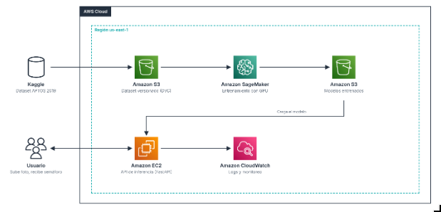
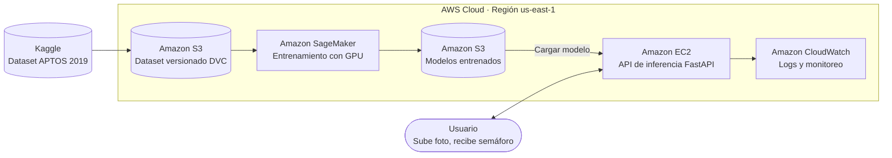

# Arquitectura

## Flujo

1. **Kaggle → Amazon S3:** se descarga el dataset APTOS 2019 y se sube a S3, versionado con DVC.
2. **Amazon S3 → Amazon SageMaker AI:** SageMaker lee las imágenes desde S3 y entrena los modelos en una instancia con GPU.
3. **Amazon SageMaker AI → Amazon S3:** el modelo entrenado se guarda en S3 (modelos entrenados).
4. **Amazon S3 → Amazon EC2:** la API de inferencia (FastAPI) carga el modelo desde S3.
5. **Usuario ↔ Amazon EC2:** el usuario sube una foto de fondo de ojo y recibe un resultado tipo semáforo según el nivel de severidad.
6. **Amazon EC2 → Amazon CloudWatch:** se registran logs y métricas para monitorear el servicio.

Todos los servicios están en la región `us-east-1`.

## Versión en texto (Mermaid)

