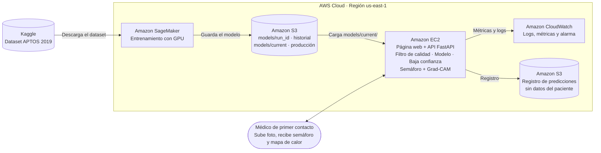

# Arquitectura

## Flujo

1. **Kaggle → Amazon SageMaker AI:** el trabajo de entrenamiento descarga el dataset APTOS 2019 directo de Kaggle y entrena el modelo en una instancia con GPU.
2. **Amazon SageMaker AI → Amazon S3:** el modelo entrenado y su `metadata.json` (umbrales de decisión y de confianza, métricas de validación) se guardan en `models/<run_id>/`, el historial completo de entrenamientos.
3. **Promoción a producción:** después de revisar las métricas de un `run_id`, se promueve copiando sus archivos a `models/current/` — ver convención abajo. Es un paso manual/deliberado, no automático.
4. **Amazon S3 → Amazon EC2:** la página web y la API de inferencia (FastAPI) cargan el modelo **siempre desde `models/current/`**, nunca de un `run_id` directamente.
5. **Médico de primer contacto ↔ Amazon EC2:** el médico sube una foto de fondo de ojo. La API aplica el filtro de calidad, clasifica la imagen y regresa el semáforo con su recomendación y el mapa de calor (Grad-CAM). Si el modelo no está seguro, manda un aviso de baja confianza para revisión humana.
6. **Amazon EC2 → Amazon S3:** cada predicción se registra en el bucket de predicciones, sin datos que identifiquen al paciente.
7. **Amazon EC2 → Amazon CloudWatch:** se envían logs y métricas (predicciones, tiempo de respuesta, errores, fotos rechazadas por calidad y distribución por clase). Una alarma avisa si la distribución de predicciones cambia de forma brusca.

Todos los servicios están en la región `us-east-1`.

## Convención de modelos en S3 ("puntero" al modelo en producción)

El bucket de modelos guarda dos cosas distintas:

- `models/<run_id>/model.pth` + `metadata.json` — **historial**: uno por cada entrenamiento, nunca se sobrescribe.
- `models/current/model.pth` + `metadata.json` + `promoted_from.json` — **el modelo en producción ahora mismo**. Es la única ruta que lee EC2.

Promover un modelo es copiar (no entrenar de nuevo) los archivos de un `run_id` a `current/`, con
`src/training/promote_model.py`. El versionado activado en este bucket protege contra una
promoción accidental: si `current/` se sobrescribe por error, se puede recuperar la versión
anterior del objeto. `promoted_from.json` deja registro de qué `run_id` y cuándo se promovió, para
trazabilidad.

No hacen falta cambios de IAM para esto: los roles ya tienen permiso sobre `models/*` completo
(SageMaker lee/escribe, EC2 solo lee), lo cual ya cubre la subcarpeta `current/` (ver
[Roles IAM](#roles-iam)). Como el rol de EC2 no puede escribir modelos, `promote_model.py` se
corre desde la terminal de un integrante con sus credenciales de AWS, no desde la instancia.

## Buckets de S3

| | Modelos | Registro de predicciones |
|---|---|---|
| Bucket | `blindness-detection-modelos-<account-id>` | `blindness-detection-predicciones-<account-id>` |
| Prefijo | `models/<run_id>/` (historial) y `models/current/` (producción) | `logs/predictions/AAAA/MM/DD/<uuid>.json` |
| Escribe | SageMaker AI (entrenamiento) y `promote_model.py` | EC2 (API) |
| Lee | EC2 (API), desde `models/current/` | — |
| Versionado | Activado | Desactivado |
| Ciclo de vida | Aborta subidas incompletas a los 7 días | Borra `logs/predictions/` a los 90 días |

Ambos buckets tienen bloqueado todo el acceso público, cifrado SSE-S3 y el tag
`Project=BlindnessDetection`. El registro de predicciones no guarda la imagen ni datos que
identifiquen al paciente.

## Roles IAM

Cada servicio tiene su propio rol con solo los permisos que necesita (mínimo privilegio). Las
políticas son en línea y los dos roles tienen el tag `Project=BlindnessDetection`.

| | `BlindnessDetection-SageMakerRole` | `BlindnessDetection-EC2Role` |
|---|---|---|
| Lo usa | Trabajos de entrenamiento de SageMaker AI (solo de nuestra cuenta) | La instancia EC2, con el perfil de instancia `BlindnessDetection-EC2Role` |
| Bucket de modelos | Leer y escribir `models/*` | Solo leer `models/*` |
| Bucket de predicciones | Sin acceso | Solo escribir `logs/predictions/*` |
| Otro S3 | Leer y escribir el bucket default `sagemaker-us-east-1-<account-id>` (código del job) | — |
| CloudWatch Logs | Grupos `/aws/sagemaker/*` | Grupos `/blindness-detection/*` |
| Métricas de CloudWatch | Namespace `/aws/sagemaker/*` | Namespace `BlindnessDetection` |
| Otros | Descargar imágenes de contenedor de ECR | — |
| Política | `BlindnessDetection-SageMakerPolicy` | `BlindnessDetection-EC2Policy` |

Cómo se usan:

- **SageMaker:** el estimator recibe `role="arn:aws:iam::<account-id>:role/BlindnessDetection-SageMakerRole"`.
- **EC2:** al lanzar la instancia, en *Advanced details → IAM instance profile*, se elige
  `BlindnessDetection-EC2Role`. La API usa esas credenciales automáticamente (sin llaves en el código).
- **API:** los logs van a un grupo que empiece con `/blindness-detection/` (p. ej.
  `/blindness-detection/api`) y las métricas al namespace `BlindnessDetection`; con otros nombres
  CloudWatch los rechaza.

## Versión en texto (Mermaid)

