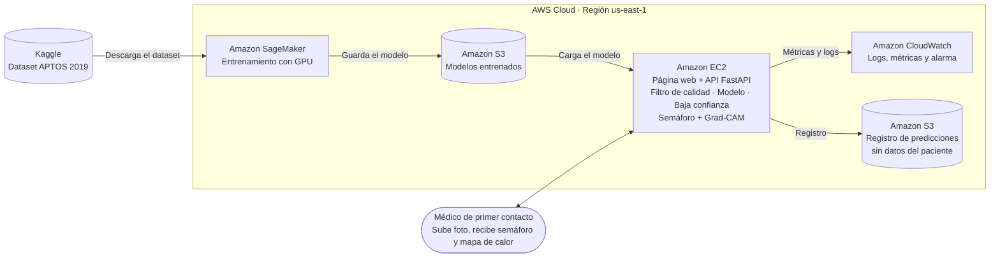

# Arquitectura

## Flujo

1. **Kaggle → Amazon SageMaker AI:** el trabajo de entrenamiento descarga el dataset APTOS 2019 directo de Kaggle y entrena el modelo en una instancia con GPU.
2. **Amazon SageMaker AI → Amazon S3:** el modelo entrenado se guarda en S3 (modelos entrenados).
3. **Amazon S3 → Amazon EC2:** la página web y la API de inferencia (FastAPI) cargan el modelo desde S3.
4. **Médico de primer contacto ↔ Amazon EC2:** el médico sube una foto de fondo de ojo. La API aplica el filtro de calidad, clasifica la imagen y regresa el semáforo con su recomendación y el mapa de calor (Grad-CAM). Si el modelo no está seguro, manda un aviso de baja confianza para revisión humana.
5. **Amazon EC2 → Amazon S3:** cada predicción se registra en S3, sin datos que identifiquen al paciente.
6. **Amazon EC2 → Amazon CloudWatch:** se envían logs y métricas (predicciones, tiempo de respuesta, errores, fotos rechazadas por calidad y distribución por clase). Una alarma avisa si la distribución de predicciones cambia de forma brusca.

Todos los servicios están en la región `us-east-1`.

## Versión en texto (Mermaid)

